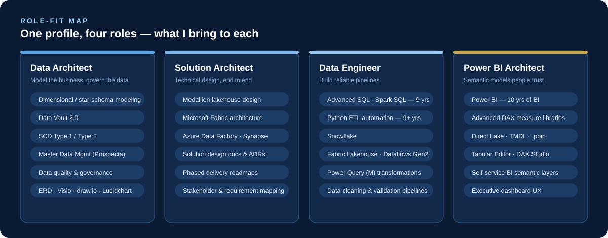
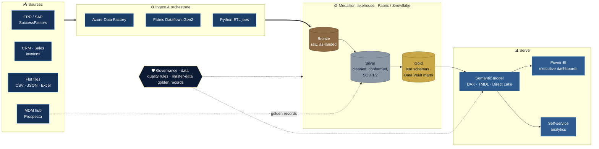
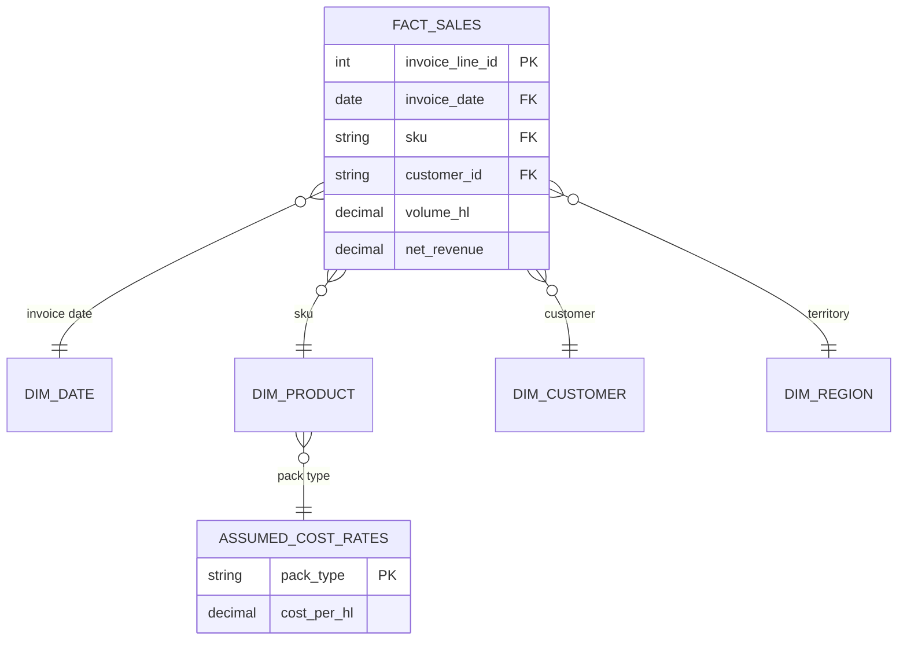
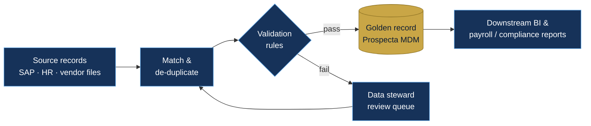
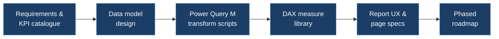
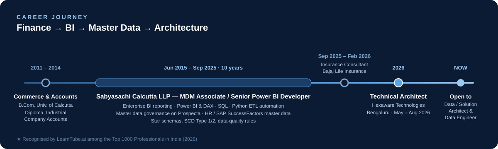
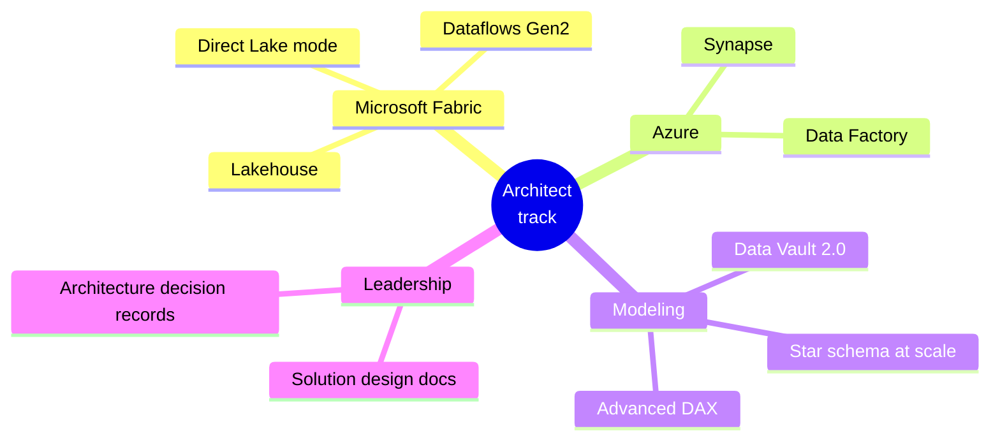

  

  
  
  
  
  

---

## 👋 About me

I design data platforms that business people actually use. Over **10 years in Business Intelligence**, I've moved from building reports to owning the whole path the data travels — **source systems → ingestion → medallion layers → governed semantic model → executive dashboard**.

My edge is that I started on the **business side** (commerce and industrial accounts) and spent a decade inside **master data management** and enterprise reporting. I model data the way finance, HR and sales teams think about it, then engineer it so it stays correct at scale.

- 🏗️ **Most recently:** Technical Architect, Hexaware Technologies (Bengaluru)
- 🗂️ **A decade at:** Sabyasachi Calcutta LLP — master data + Power BI reporting
- 🎯 **Looking for:** Data Architect · Solution / Technical Architect · Data Engineer · Power BI Architect
- 🏆 Recognised by **LearnTube.ai among the Top 1000 Professionals in India** (2026)

---

## 🧭 Where I fit

  

---

## 🏛️ Reference architecture I design and deliver

The blueprint behind most of my work — a governed, layered platform where every number on a dashboard can be traced back to its source.

**Design principles I hold to**

| Principle | What it looks like in practice |
|---|---|
| **Model for the business question** | Star schemas with conformed dimensions; grain decided with stakeholders before a single table is built |
| **History is a feature** | SCD Type 2 on dimensions that drive reporting (customer, product, employee) so past numbers never silently change |
| **One version of the truth** | Master data golden records feed the Silver layer — duplicates are fixed upstream, not patched in DAX |
| **Assumptions are swappable** | Business assumptions live in their own tables (e.g. cost rates), so finance can replace them without touching the model |
| **Built to be maintained** | Semantic models in TMDL / `.pbip` for source control, measure libraries organised by domain |

---

## 🚀 Featured work

### 1 · Sunrise Beverages — sales & profitability analytics (Power BI + Microsoft Fabric)

> Technical case study for a Senior Data Analyst (Power BI & Fabric) role: **15,000 invoice lines, 2024 – 2026**, turned into a decision-ready model and a 14-page business summary.

Model shape (simplified):

| Aspect | Detail |
|---|---|
| **Challenge** | Source data had **no cost column**, yet the business needed profitability |
| **Architecture decision** | Introduced an `AssumedCostRates` table (cost per HL by pack type) — profit is calculated transparently and finance can swap in standard costs later with zero model changes |
| **Delivered** | Star-schema model in Power Query / **TMDL**, **51 DAX measures**, **5 report pages**, `.pbix` + `.pbip` project, 14-page business summary |
| **Stack** | `Power BI` `DAX` `Power Query M` `TMDL` `Microsoft Fabric` |

---

### 2 · Enterprise master data management & HR data governance

> A decade of keeping enterprise master data clean, governed and reporting-ready at Sabyasachi Calcutta LLP.

- Maintained master data on **Prospecta** as the single source for downstream reporting
- Managed **employee (HR) master data** with **SAP HCM / SuccessFactors Employee Central**, supporting **payroll, PF, ESI and labour-law compliance** reporting
- Built **Power BI** reporting and **Python / SQL** automation on top of governed master data

**Stack:** `Prospecta` `SAP SuccessFactors` `SQL` `Python` `Power BI`

---

### 3 · Interactive sales performance dashboards (HTML / JavaScript + Plotly.js)

> Web-native executive dashboards — proof that I can deliver insight outside the Power BI canvas too.

- **CSV / JSON ingestion** with a data-cleaning pipeline in the browser
- Advanced visuals: **choropleth maps, donut charts, spline-area trends, grouped bars**
- Responsive layouts with **dark and light themes**, iterated against detailed design specs

**Stack:** `JavaScript` `Plotly.js` `HTML` `CSS`

---

### 4 · Enterprise Power BI dashboard blueprints

> Full specification-to-build packages for large dashboards, including a **FIBO Sports Products** sales dashboard and a **Vande Bharat Express** operations dashboard.

**Stack:** `Power BI` `DAX` `Power Query M` `Data modeling`

---

## 🧰 Tech stack

**Data platforms & engineering**

**Languages**

**BI, modeling & governance**

**Architecture & design tools**

**Modeling patterns I apply in real projects:** Star schema · **Data Vault 2.0** · **SCD Type 1 / 2** · **Medallion (Bronze / Silver / Gold)** · Direct Lake

---

## 📈 Career journey

  

---

## 🔭 Currently levelling up

---

## 🤝 Let's talk

I'm an **immediate joiner**, open to roles in **Bengaluru, Pune, remote**, and international opportunities (**UAE, Saudi Arabia, UK/Europe, US/Canada, Australia, Singapore**).

  
  
  <!-- Add your email badge here:
  
  -->

Languages: English · Hindi · Bengali
